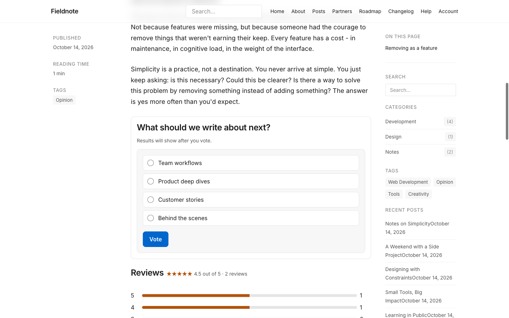
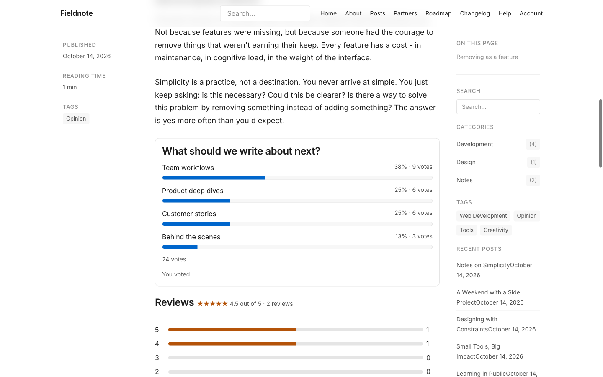
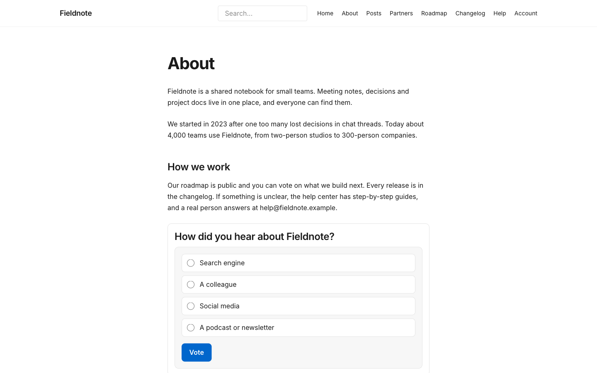
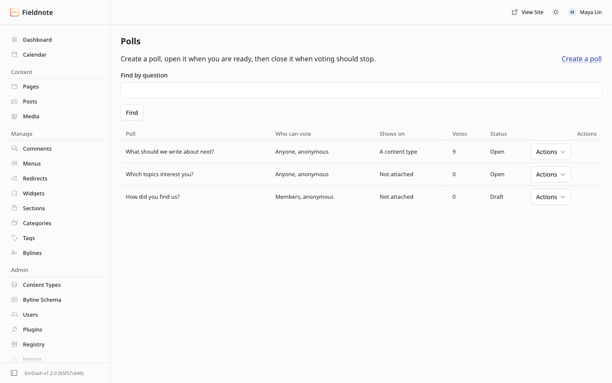
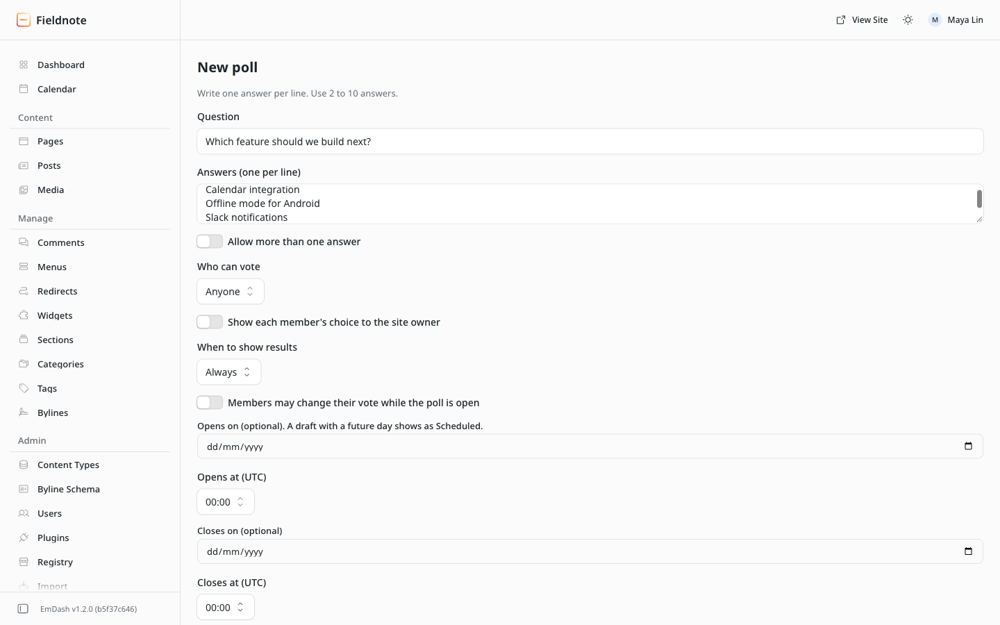

<h3 align="center">Ask a question, show live results</h3>

Create polls, let visitors or members vote once, and show live results anywhere on your EmDash site.

  <a href="https://plugins.emdashcms.com/plugins/@vapvarun.bsky.social/polls"><b>Install from the EmDash registry</b></a>
  &nbsp;·&nbsp;
  <a href="docs/website/getting-started/introduction.md">Read the docs</a>
  &nbsp;·&nbsp;
  <a href="CHANGELOG.md">What's new</a>

## Who it is for

A blogger asking readers what to write next, a shop gathering opinions, or a membership site that wants a quick vote. If you want polls on your EmDash site without a separate service, WB Polls is for you.

## What you get

**For you, the site owner**

- **Polls with two to ten answers**, one choice or several.
- **Open, close or schedule.** Open a poll when you are ready, close it by hand, or set a close time.
- **You choose who votes and who sees results.** Anyone or signed-in members only, and results always, after a vote, or after the poll closes.
- **Anonymous totals or named results.** Names are visible to you only.
- **Show a poll where you want it.** On one page, on every entry of a content type, or across the whole site.
- **Copy a poll** into a new draft with no votes.

**For your visitors and members**

- **One vote each**, with live results.
- **My votes.** A signed-in member can see the polls they voted in and erase their own votes.
- **Dark mode** that follows the visitor's system setting.

  
  

## Get started

1. In your EmDash dashboard, open **Registry**, search for **WB Polls** and install it. Your site needs a sandbox runner first, and the [install guide](docs/website/getting-started/install.md) shows how.
2. Copy the site kit into your site once, with the one command in the guide.
3. Create your first poll, open it and attach it to a page. See [Your first poll](docs/website/getting-started/first-poll.md).

  
  

## Good to know

- **Guests can vote only when your host gives EmDash the visitor's address,** for example on Cloudflare. Without it, guests are asked to sign in.
- **No poll in the middle of an article** from a registry install. Place it above or below the content, or in a template.
- **Only you create polls.** There is no member-created poll, poll list page or export yet.
- **Free, with no paid version.**

## Docs

- [Introduction](docs/website/getting-started/introduction.md)
- [Install](docs/website/getting-started/install.md)
- [Your first poll](docs/website/getting-started/first-poll.md)
- [Use cases](docs/website/getting-started/use-cases.md)
- [Where polls show](docs/website/features/where-polls-show.md)
- [Wording and look](docs/website/customize/wording-and-look.md)
- [FAQ](docs/website/faq/faq.md) and [Troubleshooting](docs/website/troubleshooting/troubleshooting.md)

## More from Wbcom Designs for EmDash

[Learnomy](https://github.com/wbcomdesigns/emdash-learnomy) courses · [Listora](https://github.com/wbcomdesigns/emdash-listora) directories · [WB Reviews](https://github.com/wbcomdesigns/emdash-reviews) · [Product Roadmap](https://github.com/wbcomdesigns/emdash-roadmap) · [KnowX](https://github.com/wbcomdesigns/emdash-knowx)

Found a bug or have an idea? [Open an issue](https://github.com/wbcomdesigns/emdash-polls/issues). Want to build on WB Polls? Start with [CONTRIBUTING.md](CONTRIBUTING.md).

MIT licence. Made by [Wbcom Designs](https://wbcomdesigns.com).
