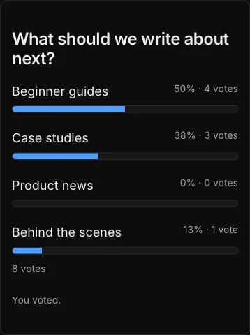

# Wording and look

**Included in Free.** WB Polls has no paid version.

## Change the words visitors see

Every phrase on the poll and on My votes lives in one file your developer copied: `src/lib/polls-strings.ts`. Change a phrase there and rebuild the site. For example:

```ts
hidden: "Results will show after you vote.",
voted: "Thanks, your vote is in.",
```

This is also how you translate the poll into another language. Error messages are in the same file, so nothing a visitor reads is hidden elsewhere.

## Match your theme

The poll takes its colours from your site's theme when it can:

- The card background follows your theme's background colour.
- The Vote button and the result bars follow your theme's brand colour.
- Light and dark mode follow the visitor's system setting, the same way the EmDash blog theme does.

To change the poll's look only, edit `src/styles/polls.css`. Its rules all start with the poll's own markers, so they never change other parts of your site, and other plugins never change the poll.



## Several Wbcom plugins on one site

WB Polls works on its own, and next to any other Wbcom plugin. They share two small files (`wbcom-kit.ts` and `wbcom-base.css`). Keep the copy with the higher number on its first line; each plugin works with a newer copy.
