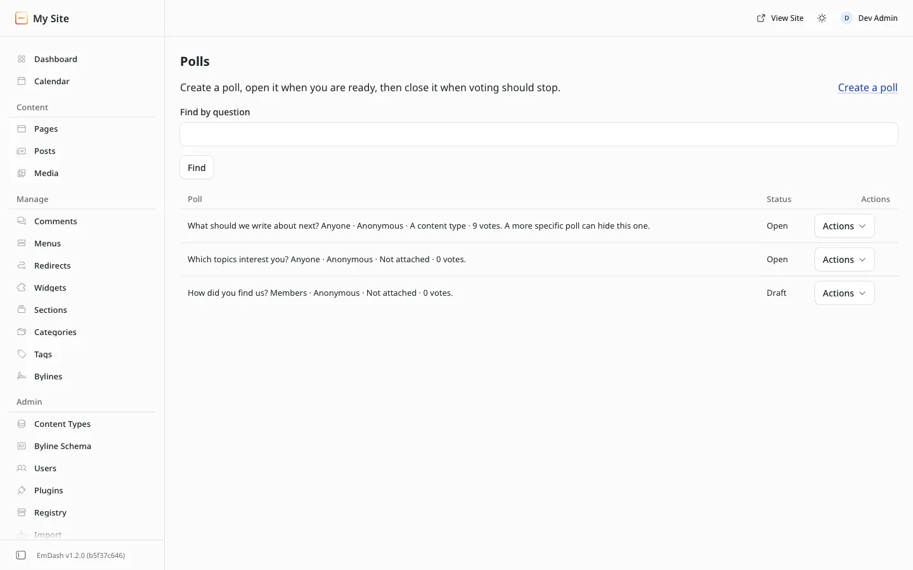

# Open, close, copy and delete

**Included in Free.** WB Polls has no paid version.

Everything happens on the **Polls** screen. The top shows how many polls are open and how many votes came in this week. Each row shows the question, who can vote and whether it is named, where it shows, the vote count and a status badge. **Find by question** narrows a long list. A long list shows 25 polls at a time.

## Statuses

| Status | Meaning | Visitors see |
| --- | --- | --- |
| Draft | Saved, not published | Nothing |
| Scheduled | A draft with an open day in the future. It opens by itself on that day | Nothing until then |
| Open | Taking votes | The poll |
| Closed | Voting stopped | The results, under "This poll is closed." |

## The Actions menu

- **Edit:** change the poll. See below for what is locked once people have voted.
- **Open:** start taking votes now.
- **Close:** stop voting now (offered on open polls). A poll can also close by itself on its **Closes on** day.
- **Results:** a bar chart, totals, shares and, on a named poll, each member's choice.
- **Copy:** makes a new draft with the same question, answers and settings, and no votes. The copy opens for editing with "(copy)" after the question so you can rename it. Use it to run the same question again later.
- **Delete:** removes the poll and all its votes. You confirm once on the next screen. This cannot be undone.

A closed poll can be opened again from the same menu.

## Editing a poll that has votes

To keep results honest, once a poll has votes you can still fix typos in the question and in each answer, but you cannot:

- add, remove or reorder answers,
- switch between one answer and several,
- switch from anonymous to named.

The form says so at the top when this applies. If you need a different set of answers, copy the poll, change the copy, close the old one and open the new one.

## Schedule a poll

Set **Opens on** to a future day and pick a time in **Opens at (UTC)**. Leave the poll as a draft. It shows as **Scheduled** and opens by itself at that time. **Closes on** and **Closes at (UTC)** work the same way for the end.

Times are in UTC (London winter time). EmDash does not tell plugins your site's time zone, so convert your local time when you pick. For example, 09:00 in New York in winter is 14:00 UTC.
