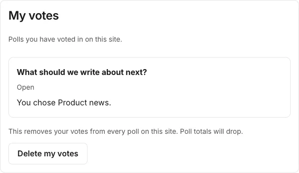

# My votes for members

**Included in Free.** WB Polls has no paid version.

Members who are signed in to your site can see every poll they voted in, and delete their own votes. The page lives at `/account/votes` once your developer has copied the site kit (see [Install](../getting-started/install.md)).

## What a member sees

- Each poll they voted in, its status, and what they chose.
- **Delete my votes**, which asks for a second click before it removes their votes from every poll on the site. Totals drop to match. A member with votes in hundreds of polls is erased in a few steps the page runs by itself.
- If they have not voted yet, a short note saying so.
- If they are not signed in, a plain prompt to sign in.

## Guests

Guests who vote are not signed in, so they have no My votes page. Their votes stay anonymous.

## Link it in your menu

In admin, open **Menus** and add a link named **My votes** to `/account/votes`. The page works for every member with no setup beyond the kit.
