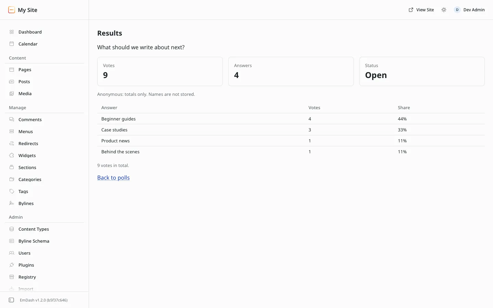

# Results and voters

**Included in Free.** WB Polls has no paid version.

## In admin

On the **Polls** screen, choose **Actions** on a poll, then **Results**.

You see:

- **Votes**, **Answers** and **Status** at the top.
- A bar chart of the answers.
- A table with each answer's votes and share.

### Named polls

If **Show each member's choice to the site owner** is on, the Results screen also lists each signed-in member and what they chose, 25 at a time. Guests are never named, even on a named poll.

Each member row has **Remove votes**, which removes that member's votes from this poll. Use it when a member asks you to remove their data. If the poll is still open, they can vote again.

A poll that already has votes cannot be switched from anonymous to named, because the people who voted were told their choice was private.

## On your site

**When to show results** on the poll form decides what visitors see:

| Setting | Before voting | After voting | After the poll closes |
| --- | --- | --- | --- |
| Always | Answers and the Vote button | Results with bars | Results with bars |
| After voting | Answers, and "Results will show after you vote." | Results with bars | Results with bars, for everyone |
| After the poll closes | Answers, and "Results will show after the poll closes." | "You voted." | Results with bars |

**Numbers visitors see** chooses between a percent and a count next to each answer, or the percent only. Admin always shows both.

## Dashboard

The EmDash dashboard has an **Open polls** card that lists the polls open right now with their vote counts.
