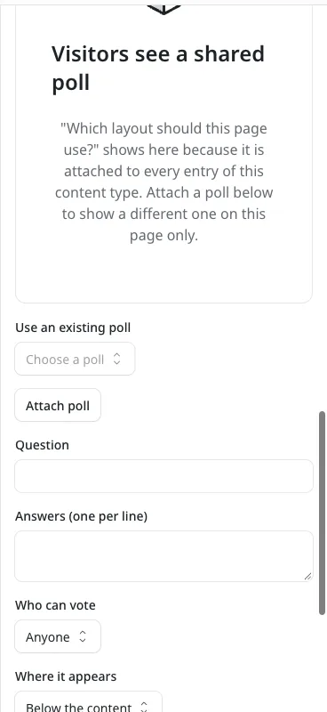

# Where a poll shows

**Included in Free.** WB Polls has no paid version.

A poll shows on your site only when two things are true: it is **Open** (or **Closed**, which still shows the results), and it is attached to the page a visitor is on. You attach it with **Where it shows** on the poll form, or from the post editor.

## The three places

| Where it shows | Visitors see it on | Set it from |
| --- | --- | --- |
| One page | One post or page | The **Poll** panel in that post's editor |
| One content type | Every entry of one type, for example every post | The poll form: **One content type**, then pick the type |
| Whole site | Every post and page that has a poll slot | The poll form: **Whole site** |

**Not attached** keeps a poll off your pages. Use it while you prepare a poll, or for a poll your developer places by hand.

## When more than one poll could show

Each page shows one poll. WB Polls picks it in this order:

1. An open poll attached to this page.
2. An open poll attached to its content type.
3. An open poll attached to the whole site.
4. If none of those is open, the newest closed one, in the same order, so visitors still see final results.

So a poll on one page wins over the one for all posts. The Polls list reminds you with "A more specific poll can hide this one" on polls attached to a content type or the whole site.

## Attach a poll from the post editor

Open a post or page in admin and expand the **Poll** panel in the right sidebar.



- If the post already shows a poll from its content type or the whole site, the panel names it under **Visitors see a shared poll**.
- **Use an existing poll** attaches a poll you already made to this page only.
- The form below creates a new poll for this page. Leave **Open now so visitors can vote** on to publish it straight away.

When a poll is attached to the page, the panel shows its question, status and vote count, with **Open** and **Remove from this page**. Removing only detaches it; the poll and its votes stay in Polls.

## Above or below the content

**Position on the page** on the poll form chooses above or below the article. For this to take effect, the template needs a slot on each side of the content, each marked with its side:

```astro
<PollSlot collection={entry.collection} id={entry.id} position="above" />
<!-- the content -->
<PollSlot collection={entry.collection} id={entry.id} position="below" />
```

A template with a single slot and no `position` shows every poll in that one place, whatever its Position setting.

## Placing one poll by hand

A developer can show a specific poll anywhere in a template, outside the slot:

```astro
---
import Poll from "../components/Poll.astro";
---
<Poll id="p_..." />
```

The poll's id is in the address bar when you edit it in admin.
