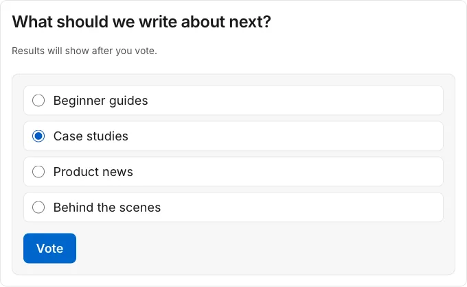
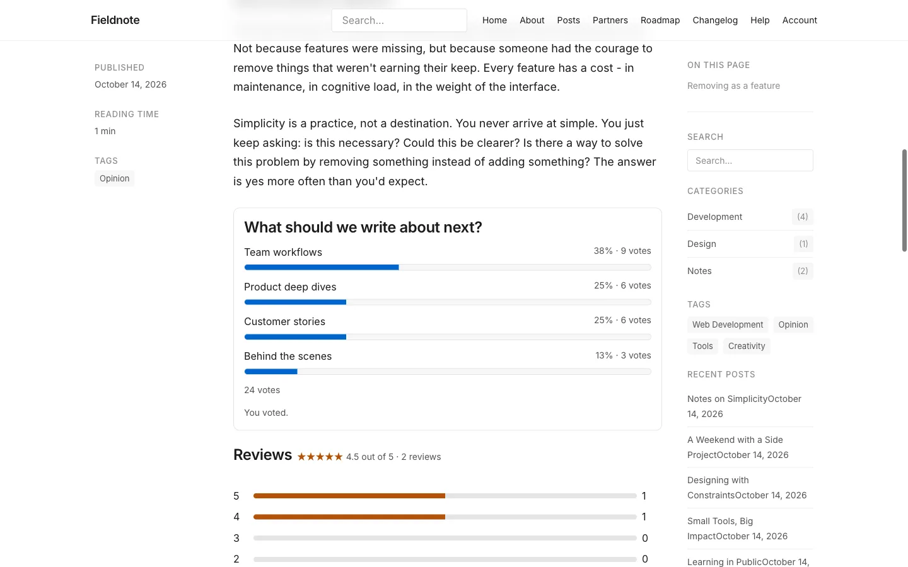

# Your first poll

**Included in Free.** WB Polls has no paid version.

This walks through one poll from start to finish: a question at the end of every blog post.

## 1. Create the poll

1. In admin, open **New poll**.
2. **Question:** `What should we write about next?`
3. **Answers (one per line):**

   ```
   Beginner guides
   Case studies
   Product news
   Behind the scenes
   ```

4. **When to show results:** After voting. Visitors see the totals once they have voted.
5. **Where it shows:** One content type. Then pick **Posts** in the next field.
6. Choose **Create poll**.


A new poll starts as a **Draft**. Visitors do not see it yet.

## 2. Open it

On the **Polls** screen, choose **Actions** on your poll, then **Open**. The status changes to **Open** and the poll appears on every post.


## 3. See it as a visitor

Open any post on your site in a private window. The poll sits where your developer placed the slot.



After voting, the visitor sees the results.



## 4. Read the results

Back in admin, choose **Actions**, then **Results**. You see the total, each answer's count and share, and the status.

## What next

- [Where a poll shows](../features/where-polls-show.md): one page, every post, or the whole site.
- [Poll form reference](../settings/poll-form.md): every option on the form.
