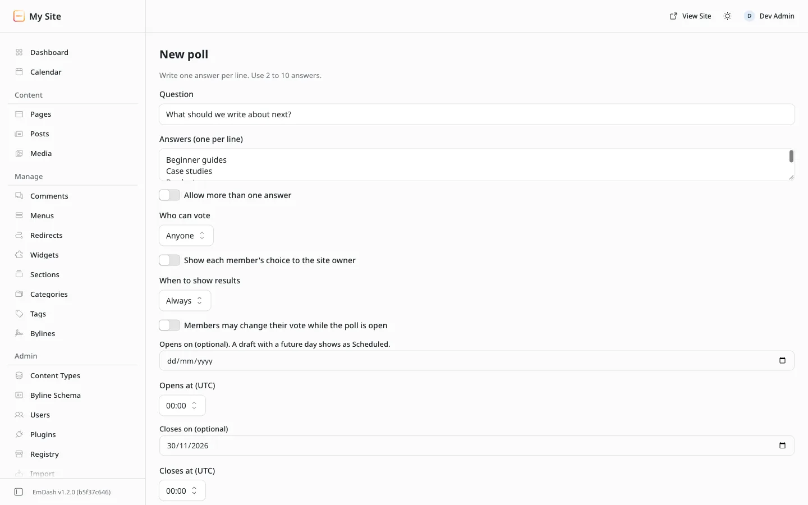

# Poll form reference

**Included in Free.** WB Polls has no paid version.

Every field on the **New poll** and **Edit poll** form, in the order it appears. One **Save** stores the whole form. Block Kit cannot put an accordion inside a form, so the groups stay together.

| Field | What it controls | Default |
| --- | --- | --- |
| Question | The question visitors see. Up to 200 characters | Empty, required |
| Answer 1, Answer 2, ... | One field per answer, in the order visitors see them. The next field appears when you fill the last one, up to 10 | Empty, at least 2 required |
| Allow more than one answer | Visitors tick several answers instead of picking one | Off |
| Who can vote | **Anyone**, or **Signed-in members only**. Members-only polls ask guests to sign in | Anyone |
| Show each member's choice to the site owner | A named poll. You see each member's choice in Results, and visitors see a note before voting that their choice is visible to you. Guests stay anonymous | Off |
| Members may change their vote while the poll is open | Signed-in members can pick again until the poll closes | Off |
| When to show results | **Always**, **After voting**, or **After the poll closes** | Always |
| Numbers visitors see | **Percent and count**, or **Percent only** | Percent and count |
| Thank-you line after voting | A short line shown after a vote. Up to 140 characters | Empty |
| Where it shows | **Not attached**, **Whole site**, or **One content type**. **One page** appears here when the poll was attached from a post editor | Not attached |
| Content type | Which type the poll shows on, by name. Appears only for **One content type** | None |
| Position on the page | **Below the content** or **Above the content**. Appears once the poll is attached. See [Where a poll shows](../features/where-polls-show.md#above-or-below-the-content) | Below the content |
| Opens on, Opens at (UTC) | A day the poll opens by itself, and the time on that day. The time appears once you pick a day. Leave the day empty to open it by hand | Empty |
| Closes on, Closes at (UTC) | A day and time the poll closes by itself. The time appears once you pick a day | Empty |

## Rules the form checks

- At least 2 and at most 10 answers.
- The question cannot be empty. Empty answer fields are skipped.
- On a poll that has votes, the answers and the one-or-several choice are locked. See [Open, close, copy and delete](../features/manage-polls.md#editing-a-poll-that-has-votes).

## How guest votes are counted

A guest can vote once per poll, counted by the visitor's internet address (an IPv6 visitor by their /64 network), stored only as a scrambled code. Your hosting has to pass that address to EmDash: Cloudflare does, other hosts need `trustedProxyHeaders` set to a header your proxy writes itself (see [Guest voting](../getting-started/install.md#guest-voting)). Without it, guests are asked to sign in. For polls where one-vote-per-person matters, choose **Signed-in members only**.
